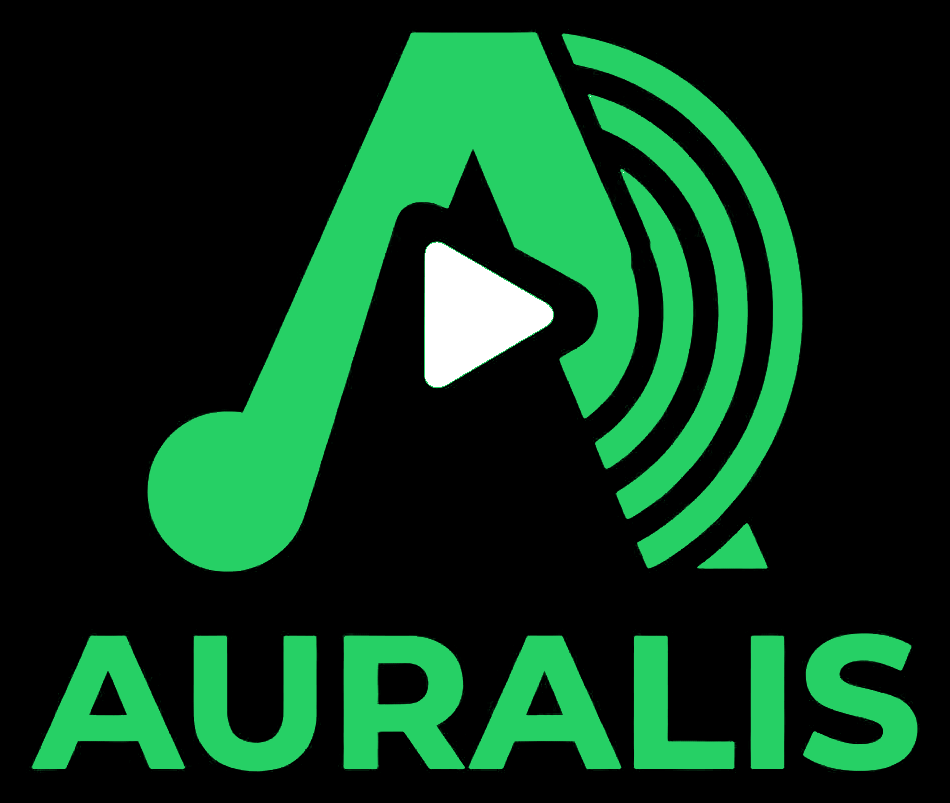
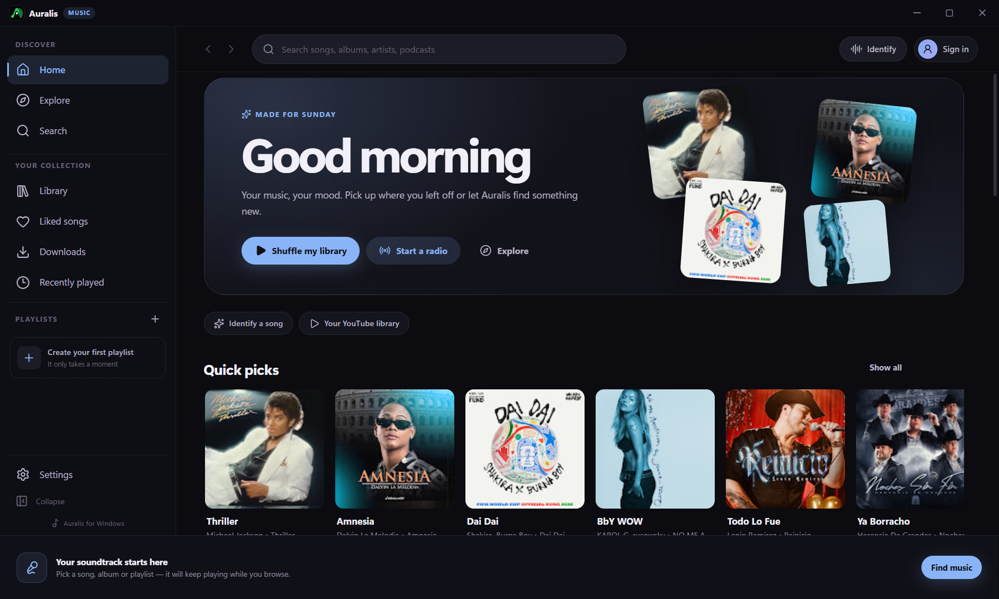
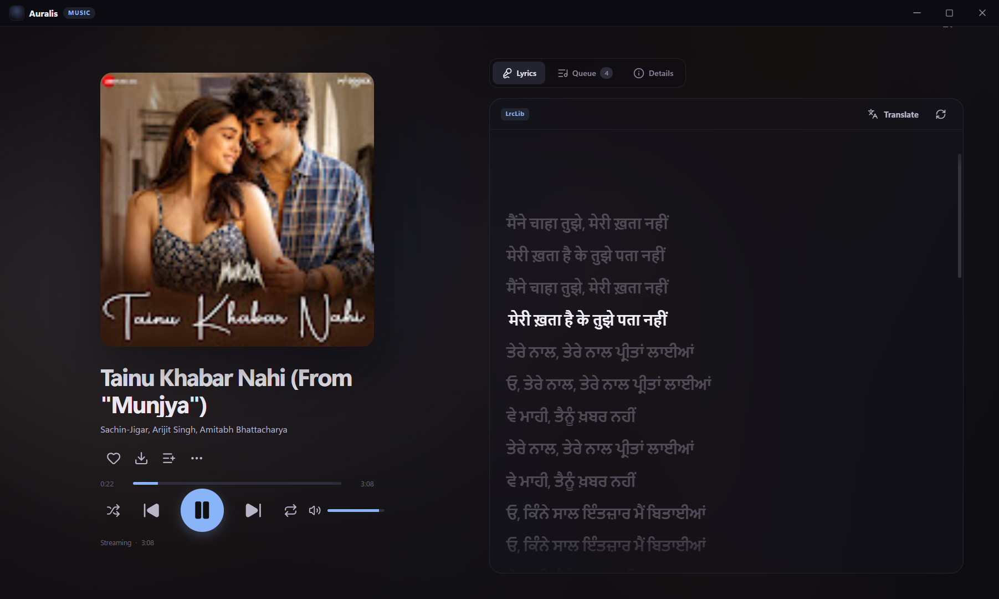
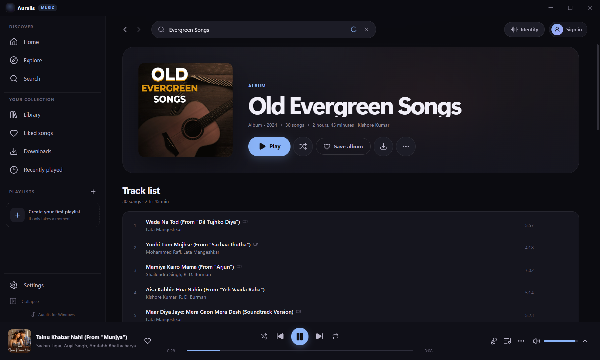
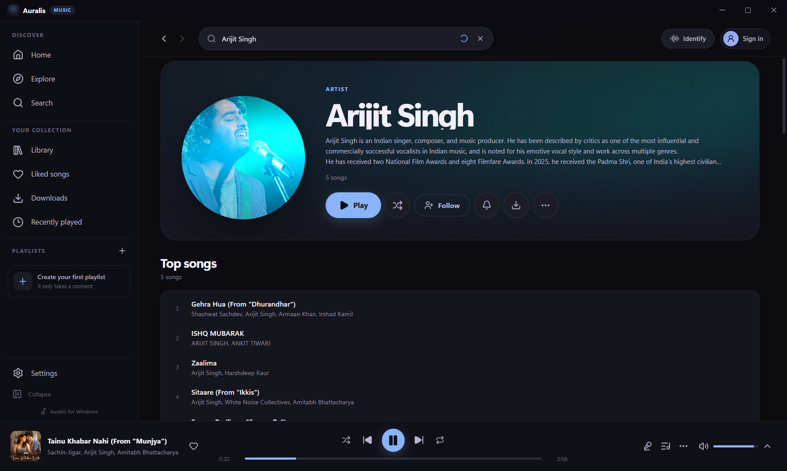
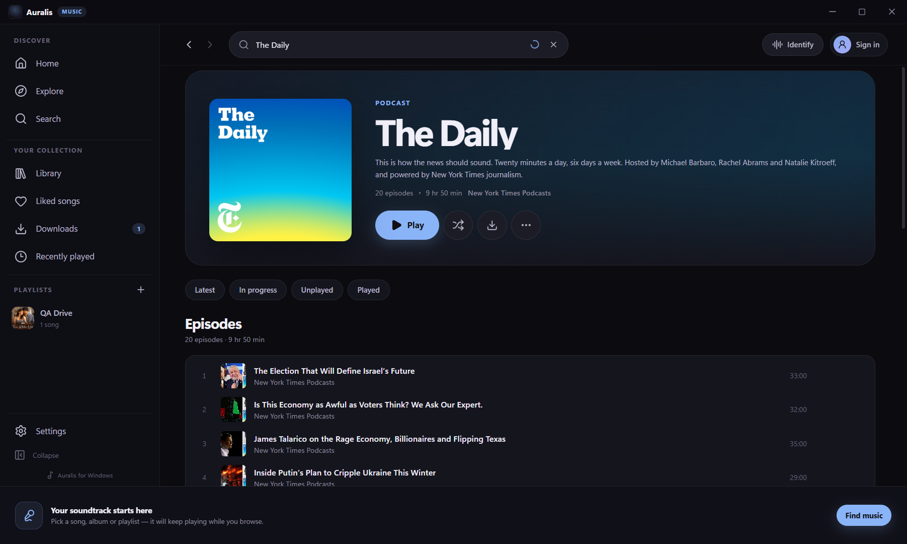
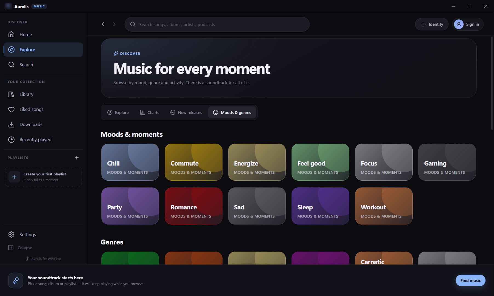
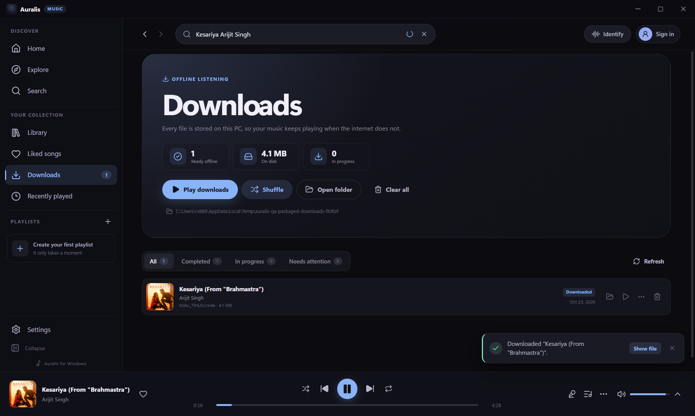

<p align="center">
  
</p>

<h1 align="center">Auralis</h1>

<p align="center">
  A native-feeling YouTube Music client for Windows 10 and 11, Linux x64 and Android.<br />
  Browse, stream, queue, sing along and listen offline — in one focused desktop app.
</p>

<p align="center">
  <strong>Windows 1.1.3</strong> · Android 1.0.3 · <strong>Linux 1.0.2</strong> · GPL-3.0-or-later
</p>

<p align="center">
  <a href="https://github.com/Rahuldhundhara/auralis/releases/tag/v1.0.2-linux.1"><strong>Download Auralis for Linux 1.0.2</strong></a>
  · AppImage · Debian package
</p>

> Auralis is an independent, unofficial client. It is not affiliated with, endorsed by or sponsored by YouTube or Google. You are responsible for how you use it and for following the terms of the services you access.



## What's inside

Auralis is a complete desktop front end for YouTube Music. It talks to the same live catalogue through YouTube Music's web API, resolves audio with a bundled `yt-dlp`, and plays it through an HTML5 audio pipeline with a Web Audio equalizer.

| | |
|---|---|
| **Home** | Personalised home feed, animated hero with a live now-playing card, quick picks, mixes, charts, new releases, moods and genres |
| **Explore** | Featured-track hero with a canvas palette and live waveform, plus a 15-mood photo grid that opens real YouTube Music mixes |
| **Search** | Dedicated search page with live suggestions, removable history chips, songs/videos/albums/artists/playlists/podcasts filters and continuation without duplicates |
| **Details** | Album, playlist, artist and podcast pages with continuation and full track/episode lists |
| **Player** | Seek, volume, speed, repeat, shuffle, queue, radio/automix with queue-end autoplay, prefetch, sleep timer, streaming quality and media keys |
| **Now Playing** | Queue-first panel, full-screen artwork, accessible tabs, synced lyrics and original/translated language switching |
| **Lyrics** | Seven providers, including BetterLyrics, LyricsPlus, LRCLIB, KuGou and YouTube, plus optional DeepL/OpenAI translation with your own key |
| **Library** | Likes, local playlists, saved albums and artists, recently played, history and search history; account playlists are merged under **From YouTube Music** |
| **YouTube Music** | Signed-in account history and every account playlist in a songs-only view, with private playlists and inline track lists |
| **Downloads** | Offline audio downloads with live progress, cancel, delete and auto-download for liked songs |
| **Integrations** | YouTube Music account, Last.fm scrobbling, Discord Rich Presence and Shazam recognition |
| **Desktop** | Frameless window, animated cold-start logo, tray icon, close-to-tray, keyboard shortcuts and Windows media controls; the separate Linux 1.0.2 builds add MPRIS |
| **Look and feel** | Smoked-glass shell over flat content, bundled Manrope and Bricolage Grotesque, emerald default accent, dark/black/light/system themes, eight accent colours, 10-band EQ with presets and bass boost |

### Screens

| Now Playing | Album |
| --- | --- |
|  |  |

| Artist | Podcast |
| --- | --- |
|  |  |

| Moods & genres | Downloads |
| --- | --- |
|  |  |

## Install

Download the latest Windows x64 build from the [GitHub Releases page](https://github.com/Rahuldhundhara/auralis/releases/latest):

| Build | File | Use it when |
| --- | --- | --- |
| Installer | [`Auralis-Setup-1.1.3.exe`](https://github.com/Rahuldhundhara/auralis/releases/latest/download/Auralis-Setup-1.1.3.exe) | You want Start menu and desktop shortcuts, and an uninstaller |
| Portable | [`Auralis-Portable-1.1.3.exe`](https://github.com/Rahuldhundhara/auralis/releases/latest/download/Auralis-Portable-1.1.3.exe) | You want a single executable that does not need installation |

The installer is per-user by default, so it does not need administrator rights. Both builds are self-contained: Electron provides the runtime and the audio tools travel inside the app, so no separate browser runtime is required.

These community builds are not code-signed, so Windows SmartScreen may show "Windows protected your PC". Choose **More info → Run anyway** after checking the SHA-256 against [`SHA256SUMS.txt`](https://github.com/Rahuldhundhara/auralis/releases/latest/download/SHA256SUMS.txt). Code signing is the only reason for that prompt; the app does not need elevation.

### Linux 1.0.2

Linux x64 packages are available from the
[Linux 1.0.2 release](https://github.com/Rahuldhundhara/auralis/releases/tag/v1.0.2-linux.1).
The `.1` rebuild adds the layered animated cold-start logo; the original
`v1.0.2-linux` release remains available for reference.

| Build | File | Use it when |
| --- | --- | --- |
| AppImage | [`Auralis-1.0.2-x86_64.AppImage`](https://github.com/Rahuldhundhara/auralis/releases/download/v1.0.2-linux.1/Auralis-1.0.2-x86_64.AppImage) | You want a single portable file with no installation |
| Debian package | [`Auralis-1.0.2-amd64.deb`](https://github.com/Rahuldhundhara/auralis/releases/download/v1.0.2-linux.1/Auralis-1.0.2-amd64.deb) | You want a desktop entry, system integration and a package-managed install |

```bash
chmod +x Auralis-1.0.2-x86_64.AppImage
./Auralis-1.0.2-x86_64.AppImage

# or
sudo apt install ./Auralis-1.0.2-amd64.deb
auralis
```

Verify the download against
[`SHA256SUMS-linux.txt`](https://github.com/Rahuldhundhara/auralis/releases/download/v1.0.2-linux.1/SHA256SUMS-linux.txt):

```bash
sha256sum -c SHA256SUMS-linux.txt
```

The AppImage needs FUSE 2 (`libfuse2t64` on Ubuntu 24.04/26.04). Both Linux
builds include yt-dlp and FFmpeg and do not need a separate browser runtime.
GNOME needs the AppIndicator extension for the tray icon. See
[`docs/LINUX.md`](https://github.com/Rahuldhundhara/auralis/blob/linux-port/docs/LINUX.md)
for Wayland, keyring, sandbox and troubleshooting details.

### First run

1. Sign in with Google on the welcome screen. Auralis opens a separate, visible Chrome window for the Google form and then reads the session from its dedicated profile; the app cannot be used without an account. Sign out from **Settings → Account** to return to this screen.
2. Pick a few languages and artists in the taste setup. It is skippable, and **Settings → Music preferences → Edit preferences** reopens it with your current picks.
3. Open **Settings → Appearance** and choose a theme and accent.
4. Open **Settings → Downloads** to manage offline audio. The Windows default is `%USERPROFILE%\Music\Auralis` (configurable); the separate Linux 1.0.2 build stores downloads under `${XDG_CONFIG_HOME:-~/.config}/Auralis/offline`.
5. Configure Last.fm and Discord under **Settings → Integrations** if you use them.
6. Start typing in the search bar, open **YouTube Music**, or pick something from Home or Explore.

Every section runs on the signed-in session: Home, Search, the cloud library, account history and private playlists. There is no anonymous mode; `AURALIS_SKIP_LOGIN=1` exists only as a local QA bypass.

### YouTube Music account section

The **YouTube Music** item in the sidebar opens a songs-only view of the signed-in account:

- **History** lists recently played songs. Official music videos, UGC clips and podcast episodes are excluded.
- **Playlists** lists every playlist in the account, including private playlists, and opens each one inline. The track list stops at the playlist's real track count, so YouTube's recommendation tail never gets appended.
- The same playlists appear in **Library → Playlists** under **From YouTube Music** and are deduplicated against local playlists by their YouTube id. Official music videos are kept in playlists, while UGC clips and episodes are filtered out.

### What's new in 1.1.3

1.1.3 is the biggest UI and feature update since 1.1.0, together with a performance and package-size pass. Playback, downloads, the library and your saved settings keep working as before.

#### New look and shell

- One design system across the app: emerald `#10b981` as the new-install accent, `#090b0e` background, 256 px sidebar (78 px collapsed), 96 px player and a 64 px top bar. Saved user accents are untouched.
- Manrope for UI and Bricolage Grotesque for display are bundled as WOFF2 with their SIL OFL texts, so no font is fetched at runtime.
- Smoked-glass chrome: title bar, sidebar, top bar, search, player rail, dialogs, menus, toasts, Now Playing and the queue drawer are translucent and blurred (28-34 px) with a 1 px light seam; cards and lists stay flat. Opaque fallback when `backdrop-filter` is unavailable.
- The Electron window is frameless and its minimize/maximize/close buttons now live in the top bar, which doubles as the drag region.
- New Home hero: a thought line that rotates every 10 minutes from the current song and time of day, a live status kicker, and a now-playing card with real artwork, a four-bar level indicator, real progress and elapsed/total time plus **Open player**. The two actions are **Shuffle library** and **Start radio**.
- Jump Back In is a compact real-history grid with **See all** and refresh; an empty library hides it instead of faking content.
- The queue drawer is now **Now playing & queue** with a large current-track card (play/pause, like, open player, more, real progress). The top bar carries a live **Playing Queue** pill, and **Identify** moved into the search field.
- Explore opens on a featured-track hero driven by the player store: real cover, a canvas palette from the artwork, a live waveform from an `AnalyserNode`, an idle **Auralis Discover** state, layouts down to 560 px and reduced-motion support.
- Explore mood grid: 15 bundled CC0/CC-BY photos, each tile opening a real YouTube Music browse endpoint, 4/3/2 responsive columns and a hover lift.

#### First run and account

- Mandatory welcome screen: the shell and routes are not mounted until a YouTube Music account is connected, and signing out returns there. Its background carries a large, softly blurred Auralis mark behind the existing ambient orbs.
- Taste onboarding on first run: 18 curated languages, up to eight artists picked from the real charts and per-language artist search, a **Your artists** shelf on Home and **Edit preferences** in Settings. It can be skipped and never invents artists.
- Sign-in is visible everywhere: a permanent sidebar account card and the top-bar chip. Signed in, the card shows the real avatar, display name, channel handle and a connection dot.
- Chrome-window sign-in opens a visible real Chrome window with an Auralis-owned profile at `userData/chrome-login`; your own Chrome profile is never opened, copied or modified. Sign-in runs with no DevTools port, cookies are read by a short-lived headless Chrome after a graceful close, and a 5-minute timeout cancels. The embedded Google window remains as a fallback and the manual cookie dialog stays available.

#### YouTube Music section

- New **YouTube Music** page with two tabs. **History** is songs only, so official music videos, UGC clips and episodes never appear. **Playlists** lists every account playlist, including private ones.
- Playlists open inline and stop at the header's real track count, so YouTube's recommendation tail is never appended. They also appear in **Library → Playlists** under **From YouTube Music**, deduplicated by id.

#### Smarter playback

- A local recommendation engine learns from play events (completed versus skipped), likes, downloads and recents with a 14-day half-life. It builds **On repeat** and **Discover mix** shelves, and hides them on a fresh install instead of faking personalisation.
- Radio curation removes duplicate songs and same-name covers, avoids tracks played in the last 7 days, drops skip-prone artists, caps an artist at three rows per page, prevents back-to-back repeats and anchors loved artists at the front.
- Stations re-seed themselves up to twice when they run dry instead of stopping with "the radio station has ended".
- Playing from search always starts a related radio (top result and video cards included), and the queue auto-continues at the end.

#### Performance and package size

- Home shelves and long track rows now paint lazily. Off-screen rows skip layout and paint through `content-visibility`, so a full Home feed decodes about 60% fewer artwork pixels: 11.1 MP after scrolling the whole feed versus 27.8 MP before, and 4.8 MP while sitting on an idle shelf.
- Thumbnails are clamped to 320 px at parse time; Now Playing asks for a 640 px cover on desktop and 960 px on Android. Home shelf art no longer downloads 544 px or 1200 px variants.
- The disk caches are bounded: 128 MB HTTP cache, 64 MB media cache, and an artwork cache capped at 16 MB / 400 files. Upgrading clears the old oversized files once, through `.cache-version` and `image-cache/.version`.
- The window keeps playing in the tray with Chromium background throttling, and DevTools is opt-in with `AURALIS_DEVTOOLS=1`.
- The Windows packages got smaller: 133.33 MB portable and 145.41 MB installer, down from 140.89 MB and 153.81 MB. Only the `en-US` Electron locale ships, and `app.asar` no longer contains source maps.

### What's new in 1.1.2

- Podcast episode filters now work: **In progress**, **Unplayed** and **Played** reload the episode list in place through YouTube Music's continuation tokens, with a real empty state when nothing matches. Clicking the active chip clears the filter.
- The **Latest** chip opens the real sort menu (Latest, Oldest, Popular, Creator provided) and preserves the selected played-state filter.
- **Identify music** no longer throws `ERR_OUT_OF_RANGE`. Shazam fingerprints store peak magnitude and frequency bin as unsigned 16-bit values; the code was writing them as signed. Live checks matched “Never Gonna Give You Up” in 6.9 s and “Despacito” in 5.8 s from the Now Playing dialog.

### What's new in 1.1.1

- Playback starts in about a second instead of four. The resolver asks the Innertube player endpoint for a direct audio URL (VISIONOS first, then Android VR and iOS) instead of spawning yt-dlp per track, and keeps yt-dlp as the fallback for tracks the fast path cannot serve.
- Resolved streams are cached per track for 90 minutes and shared between a hover prefetch and the click that follows; a failed fast path cools down for two minutes instead of retrying on every track.
- The transport no longer flashes a spinner for starts under 900 ms, and the media proxy retries a dropped range request through Node's stack so a track switch cannot leave playback stuck.
- Measured on Windows: resolve 292–653 ms, click → first audio 1.13–1.32 s (was 7.52 s), hover-prefetched 0.80–0.97 s. See [`docs/QA.md`](docs/QA.md).

### What's new in 1.1.0

- An animated cold-start logo built from the supplied Auralis artwork, with a reduced-motion fallback.
- A dedicated search page: debounced suggestions, removable and clearable history, request-cancellation guards, deduplicated continuation and explicit load-more errors.
- Queue-first Now Playing with accessible tabs, a swipe-down header and lyrics that keep playing while you switch views.
- Lyrics translation with a real language picker, original/translated switching, synced timing preserved and actionable provider errors. DeepL or an OpenAI-compatible key is required; no keyless translation is faked.
- An always-visible mini-player progress rail that becomes seekable as soon as duration metadata arrives, plus an in-player streaming-quality selector that reloads at the current position.
- A horizontal Jump Back In carousel backed by real listening history, and a Create a Mix action built from local history.
- Equalizer presets and a real bass-boost low shelf on top of the 10-band curve.
- Hardened media handling: local playback is restricted to recorded downloads or the configured download roots, stream proxying requires an app-issued URL, downloads use sanitized filenames and interrupted downloads are reconciled on startup.
- Resilient startup: independent library, settings and session initialisation, preserved loaded data, retry feedback and animated splash gating.

### Linux 1.0.2 release notes

- Published AppImage and Debian packages built from the `linux-port` branch.
- Added Linux playback, MPRIS media keys, tray/AppIndicator support, app-private downloads and Linux-safe storage paths.
- Verified the packaged Linux build with live playback, radio, downloads and the full end-to-end QA pass.

## Where your data lives

| Data | Windows | Linux |
| --- | --- | --- |
| Settings and local library | `%APPDATA%\Auralis\settings.json`, `library.json` | `${XDG_CONFIG_HOME:-~/.config}/Auralis/settings.json`, `library.json` |
| YouTube Music session | `%APPDATA%\Auralis\session.json` | `${XDG_CONFIG_HOME:-~/.config}/Auralis/session.json` |
| Downloads | `%USERPROFILE%\Music\Auralis` (configurable, plain M4A) | `${XDG_CONFIG_HOME:-~/.config}/Auralis/offline` (app-private) |
| Artwork cache | `image-cache/` inside the user-data folder (at most 400 files) | `image-cache/` inside the user-data folder |
| Playback cache | Electron's per-user cache folder (128 MB HTTP, 64 MB media) | Electron's per-user cache folder |

Cookies are encrypted at rest with Electron `safeStorage`: DPAPI on Windows,
libsecret/GNOME Keyring or KWallet on Linux. The session is never encrypted with
a hard-coded key and is not uploaded anywhere.

### Performance and disk use

Auralis clamps artwork at parse time instead of decoding whatever size YouTube
returns:

- Cards, rows and the queue request the 320 px variant; video posters use
  `mqdefault` (320×180). The first Home render no longer decodes 576 px and
  1200 px covers for 180 px cards.
- Now Playing asks for a 640 px variant (960 px on Android) from the same URL,
  so only the open cover is large.
- The main process keeps a 16 MB in-memory artwork cache and at most 400 files
  on disk, pruning oldest-first. Chromium's HTTP cache is capped at 128 MB and
  the media cache at 64 MB.
- A one-time cleanup removes caches written before these limits. It is tracked
  by `.cache-version` in the user-data folder and `image-cache/.version`, so the
  first launch after upgrading clears the old oversized files only once.
- Home shelves and long track lists use `content-visibility: auto`; off-screen
  rows skip layout and paint. The tray uses Chromium background throttling, so
  audio keeps playing while a hidden window stops rendering at full rate.
- DevTools is opt-in (`AURALIS_DEVTOOLS=1`) instead of opening on every
  `npm run dev`.
- Release packaging uses maximum compression, ships only the `en-US` Electron
  locale and excludes source maps. FFmpeg (100.5 MB) and yt-dlp (17.1 MB)
  remain the largest bundled files.

Measured on Windows 11 with the production renderer and a real signed-in
session: decoded artwork fell from 27.8 MP to 11.1 MP after scrolling the whole
Home feed (about 60% less), and an idle Home shelf view holds 4.8 MP / 40 images.
The idle renderer working set measured 178 MB; after a full feed scroll it was
236–243 MB, so most of the saving is for content that is off screen. Total
working set stays around 718–772 MB because the Electron/Chromium baseline
(Browser, GPU and utility processes) dominates. Minimizing the window drops the
GPU process from about 310 MB to 250 MB. Hardware acceleration stays on by
default; turning it off saved roughly 40–85 MB in testing but moved work to the
renderer (295 MB idle versus 178 MB) and reduced UI smoothness.

A real profile measured 480 MB before these limits: 307 MB Chromium cache,
103 MB dedicated Chrome login profile, 41 MB artwork and 18 MB partitions. The
one-time cleanup runs on the first launch after upgrading; after that the HTTP,
media and artwork caches stay bounded.

The rebuilt portable measures **133.33 MB**, down from **140.89 MB**
(−7.56 MB, −5.4%), and the rebuilt Setup installer measures **145.41 MB**,
down from **153.81 MB** (−8.40 MB, −5.5%). Both ship only the `en-US` Electron
locale and no source maps in `app.asar`.

## Build from source

### Requirements

- Windows 10 or 11 x64
- Node.js 22 or newer (Node 24 recommended)
- npm
- About 1 GB of free disk space for dependencies and packaged output

Linux build prerequisites, packaging commands and troubleshooting are documented in
[`docs/LINUX.md`](https://github.com/Rahuldhundhara/auralis/blob/linux-port/docs/LINUX.md).

### Development

The release builds include yt-dlp and FFmpeg. The GitHub source tree does not:
`ffmpeg.exe` is about 105 MB, over GitHub's per-file limit. Before running the app
or packaging from source, put `yt-dlp.exe` and `ffmpeg.exe` in `resources/bin/`
(see [`resources/bin/README.md`](resources/bin/README.md)). Browsing works without
them, but playback, downloads and Shazam do not.

```powershell
npm install
npm run dev
```

`npm run dev` starts Vite on port 5173, builds the Electron main and preload bundles, and launches the app. Main-process changes need a restart; renderer changes hot-reload.

### Checks and production build

```powershell
npm run typecheck
npm run build
npm run preview
```

`npm run preview` builds and runs the production renderer without packaging.

### Installer and portable builds

```powershell
npm run dist            # Setup + portable in one run (portable comes out ~12 MB larger)
npm run dist:portable   # portable only, maximum compression
npx electron-builder --win nsis   # Setup only
```

`electron-builder` compresses the portable target better when it is the only
target in the run: a combined `--win` run produced a 145.17 MB portable, while
`--win portable` produced 133.33 MB from the same `win-unpacked` payload. Build
the two artifacts separately for release.

Packaging uses `electron-builder` with `npmRebuild: false`; the Electron main process is bundled by esbuild, so no native modules are rebuilt at package time. The bundled tools in `resources/bin` are copied into the app's `resources/bin` directory.

### Quality checks

```powershell
npm run test:api            # live Innertube parser check
node scripts/qa-full.mjs    # 21-check live end-to-end pass
node scripts/qa-upgrade.mjs # focused 1.1.0 upgrade regression pass
node scripts/qa-sleep.mjs   # focused sleep-timer regression
```

The Playwright QA scripts under `scripts/` launch the real app with an isolated user-data directory and exercise live playback, downloads, playlists, podcasts, sleep timer and settings. See [docs/QA.md](docs/QA.md).

## Architecture at a glance

```
React 19 renderer  ──window.auralis──▶  preload bridge  ──IPC──▶  Electron main
        │                                                           │
        ├─ Zustand stores                                    ├─ YouTube Music API (WEB_REMIX)
        ├─ HTML5 audio + Web Audio EQ                        ├─ yt-dlp stream and download service
        └─ auralis-media:// playback                         └─ JSON stores, safeStorage, tray
```

- **UI:** React 19, TypeScript, Vite 8, Zustand, custom CSS and lucide icons.
- **Desktop:** Electron 45, context isolation on, Node integration off, narrow preload API.
- **Catalogue:** YouTube Music Innertube (`WEB_REMIX`) with optional authenticated cookies and SAPISIDHASH.
- **Audio:** bundled `yt-dlp.exe` resolves direct audio streams; `auralis-media://` proxies range requests and CORS so the Web Audio equalizer can inspect the stream.
- **Downloads:** bundled `yt-dlp`, with bundled FFmpeg for conversion and caption extraction.
- **Persistence:** plain JSON files in Electron's user data directory; no database server, no telemetry.

See [docs/API.md](docs/API.md) for the full IPC and service reference, and [docs/PARITY.md](docs/PARITY.md) for the feature-by-feature parity matrix.

## Bundled tools

| Tool | Version | Purpose |
| --- | --- | --- |
| `yt-dlp` | 2026.10.21 | Resolve live audio streams, download tracks, fetch captions |
| FFmpeg | 9.0.2 essentials (Gyan build) | Audio conversion for downloads and Shazam fingerprint input |

The app works offline only for tracks that have already been downloaded. A network connection is required to browse and stream the live catalogue.

### Updating yt-dlp

YouTube changes its delivery formats regularly. If playback or downloads stop working after a site change:

1. Open **Settings → About** and use **Update yt-dlp**, or
2. Replace `resources/bin/yt-dlp.exe` with a fresh release, or
3. For an installed copy, replace the file in the app's `resources\bin` directory and restart Auralis.

The current version is shown in **Settings → About**.

## Troubleshooting

**A track spins or fails to start.** Try another track; if every track fails, update yt-dlp. A proxy or VPN can also cause the stream host to reject requests. Set the proxy under **Settings → Downloads → Network**.

**Downloads finish but the file will not play.** Keep FFmpeg in the app's `resources/bin` folder. Do not move the portable EXE out of its unpacked directory while it is running.

**YouTube Music login did not stick.** Click **Continue with Google** on the sign-in screen, or use **Settings → Account → Sign in with Google**. Auralis opens a separate, visible Chrome window for the login; finish the Google form there and the window closes itself after YouTube Music loads. The first sign-in asks for your password/2FA because this dedicated profile is separate from your main Chrome; it stays signed in until you sign out. If Chrome is not installed, the embedded Google window is used instead. Manual cookie paste remains under the cookie dialog. On the next cold start the session is decrypted after Electron finishes initialising, so the app should no longer bounce back to the sign-in screen. Do not share cookies with anyone.

**The window is blank on a GPU driver.** Open **Settings → General**, turn off **Hardware acceleration**, and restart.

**Search works but Home is slow on first launch.** The first feed request can take several seconds while YouTube Music builds a fresh feed session. Subsequent requests are cached for the session.

## Project layout

```
electron/            Electron main process, preload and services
  services/          Innertube, parsers, streams, downloads, lyrics, stores
shared/              Shared TypeScript types and the renderer API contract
src/                 React renderer (pages, components, stores, styles)
resources/           App icons and bundled binaries
scripts/             Build and Playwright QA scripts
docs/                Screenshots, API notes, parity matrix and QA record
release/             Versioned installer and portable output (generated)
```

## Android

Auralis also ships as a native Android app. It uses the same React renderer inside a
WebView shell, with a local HTTP bridge, a foreground playback service and bundled
yt-dlp. The Android build lives in [`android/`](android/README.md); see that guide
for prerequisites, signing and the exact Gradle commands.

The Windows and Android clients share the renderer, so desktop-only code paths stay
behind platform checks and Android-specific layout rules are scoped to the
`is-android` root class.

## License

Auralis is free software, licensed under the **GNU General Public License, version 3 or later**. See [LICENSE](LICENSE).

Bundled and third-party components keep their own licences; see [docs/THIRD_PARTY.md](docs/THIRD_PARTY.md). The GPL-3.0 text is distributed with the app.

## Acknowledgements

Built with Electron, React, Vite, Zustand, lucide, fast-xml-parser, yt-dlp and FFmpeg. Lyrics come from their respective community providers. Artwork and metadata belong to their respective rights holders and are displayed as part of the YouTube Music catalogue.
