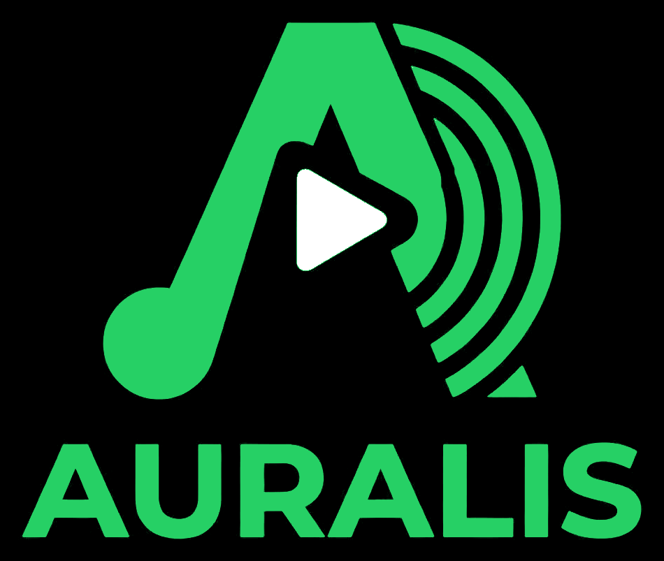
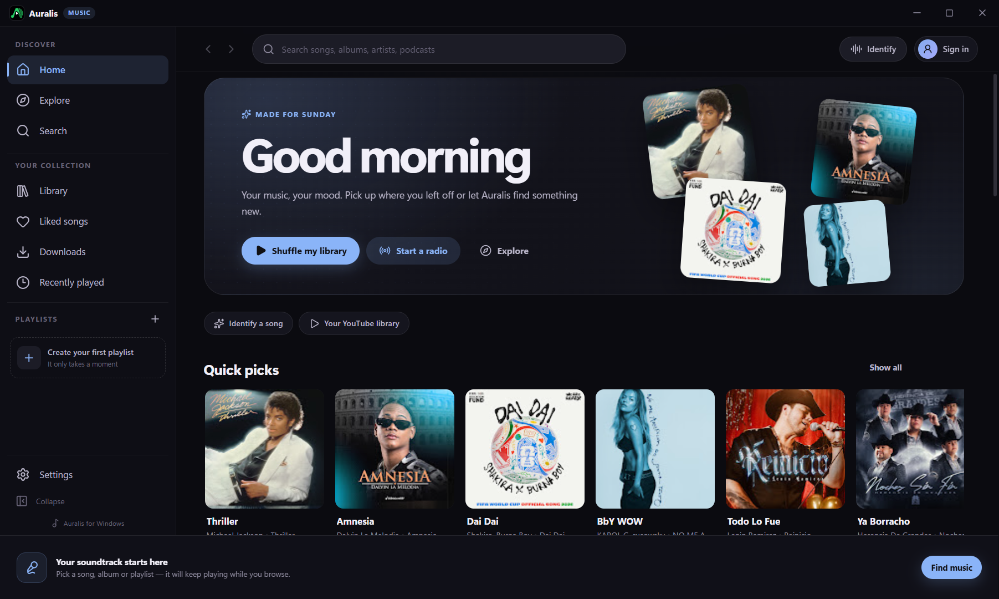
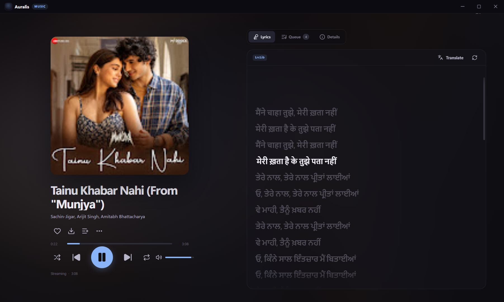
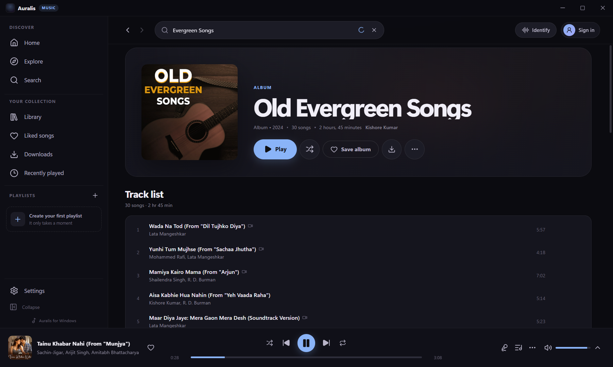
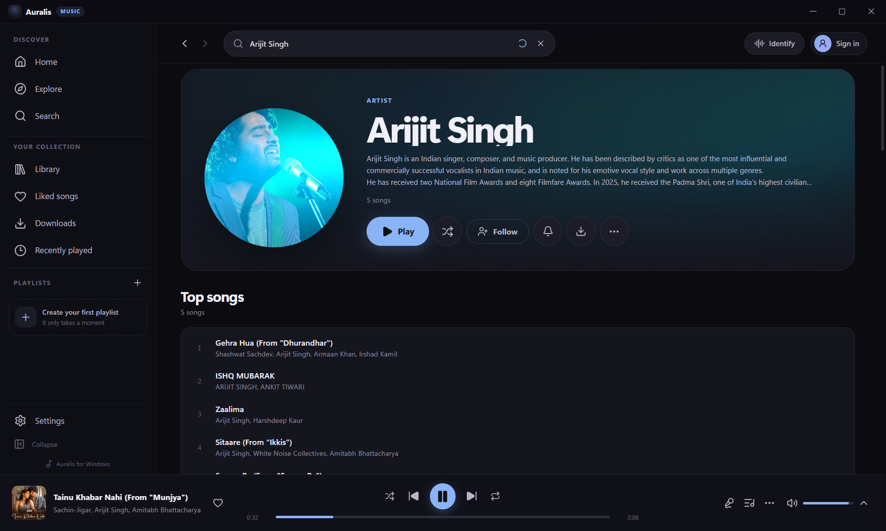
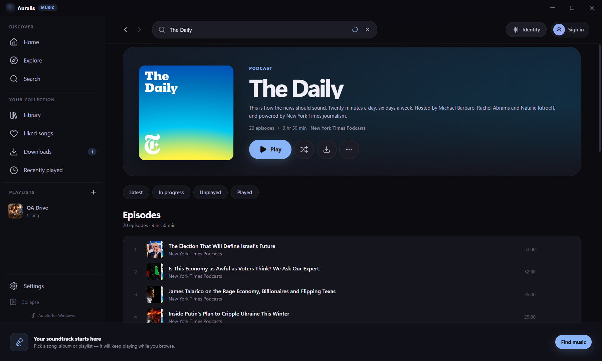
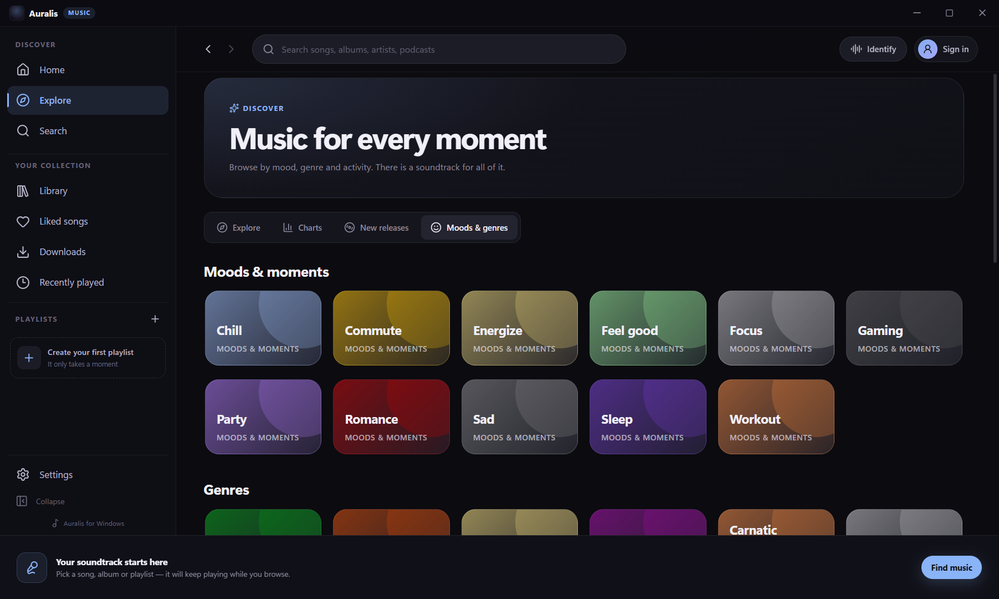
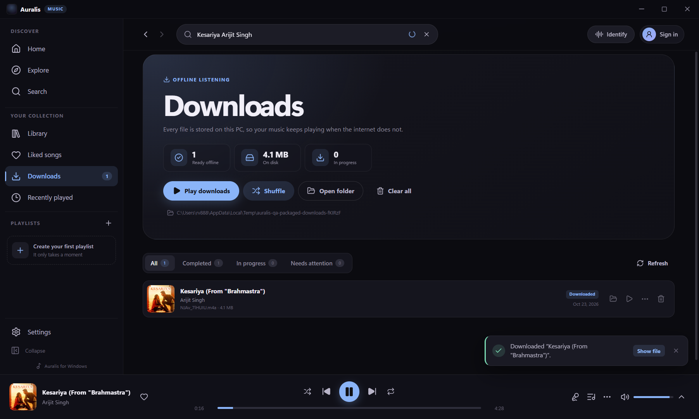

<p align="center">
  
</p>

<h1 align="center">Auralis</h1>

<p align="center">
  A native-feeling YouTube Music client for Windows 10 and 11.<br />
  Browse, stream, queue, sing along and listen offline — in one focused desktop app.
</p>

<p align="center">
  <strong>Version 1.1.0</strong> · Windows x64 · GPL-3.0-or-later
</p>

> Auralis is an independent, unofficial client. It is not affiliated with, endorsed by or sponsored by YouTube or Google. You are responsible for how you use it and for following the terms of the services you access.



## What's inside

Auralis is a complete desktop front end for YouTube Music. It talks to the same live catalogue through YouTube Music's web API, resolves audio with a bundled `yt-dlp`, and plays it through an HTML5 audio pipeline with a Web Audio equalizer.

| | |
|---|---|
| **Home** | Personalised home feed, quick picks, mixes, charts, new releases, moods and genres |
| **Search** | Dedicated search page with live suggestions, removable history chips, songs/videos/albums/artists/playlists/podcasts filters and continuation without duplicates |
| **Details** | Album, playlist, artist and podcast pages with continuation and full track/episode lists |
| **Player** | Seek, volume, speed, repeat, shuffle, queue, radio/automix with queue-end autoplay, prefetch, sleep timer, streaming quality and media keys |
| **Now Playing** | Queue-first panel, full-screen artwork, accessible tabs, synced lyrics and original/translated language switching |
| **Lyrics** | Seven providers, including BetterLyrics, LyricsPlus, LRCLIB, KuGou and YouTube, plus optional DeepL/OpenAI translation with your own key |
| **Library** | Likes, local playlists, saved albums and artists, recently played, history and search history |
| **Downloads** | Offline audio downloads with live progress, cancel, delete and auto-download for liked songs |
| **Integrations** | YouTube Music account, Last.fm scrobbling, Discord Rich Presence and Shazam recognition |
| **Desktop** | Frameless window, animated cold-start logo, tray icon, close-to-tray, keyboard shortcuts and Windows media controls |
| **Look and feel** | Material-inspired design, dark/black/light/system themes, eight accent colours, 10-band EQ with presets and bass boost |

### Screens

| Now Playing | Album |
| --- | --- |
|  |  |

| Artist | Podcast |
| --- | --- |
|  |  |

| Moods & genres | Downloads |
| --- | --- |
|  |  |

## Install

Download the latest Windows x64 build from the [GitHub Releases page](https://github.com/Rahuldhundhara/auralis/releases/latest):

| Build | File | Use it when |
| --- | --- | --- |
| Installer | [`Auralis-Setup-1.1.0.exe`](https://github.com/Rahuldhundhara/auralis/releases/latest/download/Auralis-Setup-1.1.0.exe) | You want Start menu and desktop shortcuts, and an uninstaller |
| Portable | [`Auralis-Portable-1.1.0.exe`](https://github.com/Rahuldhundhara/auralis/releases/latest/download/Auralis-Portable-1.1.0.exe) | You want a single executable that does not need installation |

The installer is per-user by default, so it does not need administrator rights. Both builds are self-contained: Electron provides the runtime and the audio tools travel inside the app, so no separate browser runtime is required.

These community builds are not code-signed, so Windows SmartScreen may show "Windows protected your PC". Choose **More info → Run anyway** after checking the SHA-256 against [`SHA256SUMS.txt`](https://github.com/Rahuldhundhara/auralis/releases/latest/download/SHA256SUMS.txt). Code signing is the only reason for that prompt; the app does not need elevation.

### First run

1. Open **Settings → Appearance** and choose a theme and accent.
2. Open **Settings → Downloads** and pick a music folder. The default is `%USERPROFILE%\Music\Auralis`.
3. Optionally connect an account under **Settings → Account**, or configure Last.fm and Discord under **Settings → Integrations**.
4. Start typing in the search bar, or pick something from Home.

Anonymous browsing works immediately. A YouTube Music account unlocks your cloud library, remote playlist edits, subscriptions and account history.

### What's new in 1.1.0

- An animated cold-start logo built from the supplied Auralis artwork, with a reduced-motion fallback.
- A dedicated search page: debounced suggestions, removable and clearable history, request-cancellation guards, deduplicated continuation and explicit load-more errors.
- Queue-first Now Playing with accessible tabs, a swipe-down header and lyrics that keep playing while you switch views.
- Lyrics translation with a real language picker, original/translated switching, synced timing preserved and actionable provider errors. DeepL or an OpenAI-compatible key is required; no keyless translation is faked.
- An always-visible mini-player progress rail that becomes seekable as soon as duration metadata arrives, plus an in-player streaming-quality selector that reloads at the current position.
- A horizontal Jump Back In carousel backed by real listening history, and a Create a Mix action built from local history.
- Equalizer presets and a real bass-boost low shelf on top of the 10-band curve.
- Hardened media handling: local playback is restricted to recorded downloads or the configured download roots, stream proxying requires an app-issued URL, downloads use sanitized filenames and interrupted downloads are reconciled on startup.
- Resilient startup: independent library, settings and session initialisation, preserved loaded data, retry feedback and animated splash gating.

## Where your data lives

| Data | Location |
| --- | --- |
| Settings and local library | `%APPDATA%\Auralis\settings.json`, `library.json` |
| YouTube Music session | `%APPDATA%\Auralis\session.json` |
| Downloads | `%USERPROFILE%\Music\Auralis` by default (configurable) |
| Playback cache | Electron's per-user cache folder |

Cookies are encrypted at rest with Electron `safeStorage`, which uses Windows DPAPI (your Windows user account). The session is never encrypted with a hard-coded key and is not uploaded anywhere.

## Build from source

### Requirements

- Windows 10 or 11 x64
- Node.js 22 or newer (Node 24 recommended)
- npm
- About 1 GB of free disk space for dependencies and packaged output

### Development

The release builds include yt-dlp and FFmpeg. The GitHub source tree does not:
`ffmpeg.exe` is about 105 MB, over GitHub's per-file limit. Before running the app
or packaging from source, put `yt-dlp.exe` and `ffmpeg.exe` in `resources/bin/`
(see [`resources/bin/README.md`](resources/bin/README.md)). Browsing works without
them, but playback, downloads and Shazam do not.

```powershell
npm install
npm run dev
```

`npm run dev` starts Vite on port 5173, builds the Electron main and preload bundles, and launches the app. Main-process changes need a restart; renderer changes hot-reload.

### Checks and production build

```powershell
npm run typecheck
npm run build
npm run preview
```

`npm run preview` builds and runs the production renderer without packaging.

### Installer and portable builds

```powershell
npm run dist            # release/<version>/Auralis-Setup-<version>.exe
npm run dist:portable   # release/<version>/Auralis-Portable-<version>.exe
```

Packaging uses `electron-builder` with `npmRebuild: false`; the Electron main process is bundled by esbuild, so no native modules are rebuilt at package time. The bundled tools in `resources/bin` are copied into the app's `resources/bin` directory.

### Quality checks

```powershell
npm run test:api            # live Innertube parser check
node scripts/qa-full.mjs    # 21-check live end-to-end pass
node scripts/qa-upgrade.mjs # focused 1.1.0 upgrade regression pass
node scripts/qa-sleep.mjs   # focused sleep-timer regression
```

The Playwright QA scripts under `scripts/` launch the real app with an isolated user-data directory and exercise live playback, downloads, playlists, podcasts, sleep timer and settings. See [docs/QA.md](docs/QA.md).

## Architecture at a glance

```
React 19 renderer  ──window.auralis──▶  preload bridge  ──IPC──▶  Electron main
        │                                                           │
        ├─ Zustand stores                                    ├─ YouTube Music API (WEB_REMIX)
        ├─ HTML5 audio + Web Audio EQ                        ├─ yt-dlp stream and download service
        └─ auralis-media:// playback                         └─ JSON stores, safeStorage, tray
```

- **UI:** React 19, TypeScript, Vite 8, Zustand, custom CSS and lucide icons.
- **Desktop:** Electron 45, context isolation on, Node integration off, narrow preload API.
- **Catalogue:** YouTube Music Innertube (`WEB_REMIX`) with optional authenticated cookies and SAPISIDHASH.
- **Audio:** bundled `yt-dlp.exe` resolves direct audio streams; `auralis-media://` proxies range requests and CORS so the Web Audio equalizer can inspect the stream.
- **Downloads:** bundled `yt-dlp`, with bundled FFmpeg for conversion and caption extraction.
- **Persistence:** plain JSON files in Electron's user data directory; no database server, no telemetry.

See [docs/API.md](docs/API.md) for the full IPC and service reference, and [docs/PARITY.md](docs/PARITY.md) for the feature-by-feature parity matrix.

## Bundled tools

| Tool | Version | Purpose |
| --- | --- | --- |
| `yt-dlp` | 2026.10.21 | Resolve live audio streams, download tracks, fetch captions |
| FFmpeg | 9.0.2 essentials (Gyan build) | Audio conversion for downloads and Shazam fingerprint input |

The app works offline only for tracks that have already been downloaded. A network connection is required to browse and stream the live catalogue.

### Updating yt-dlp

YouTube changes its delivery formats regularly. If playback or downloads stop working after a site change:

1. Open **Settings → About** and use **Update yt-dlp**, or
2. Replace `resources/bin/yt-dlp.exe` with a fresh release, or
3. For an installed copy, replace the file in the app's `resources\bin` directory and restart Auralis.

The current version is shown in **Settings → About**.

## Troubleshooting

**A track spins or fails to start.** Try another track; if every track fails, update yt-dlp. A proxy or VPN can also cause the stream host to reject requests. Set the proxy under **Settings → Downloads → Network**.

**Downloads finish but the file will not play.** Keep FFmpeg in the app's `resources/bin` folder. Do not move the portable EXE out of its unpacked directory while it is running.

**YouTube Music login did not stick.** Close the sign-in window after the account name appears, then restart. If the embedded Google sign-in is blocked, paste a `Cookie` header value under **Settings → Account → Manual cookie**. Do not share cookies with anyone.

**The window is blank on a GPU driver.** Open **Settings → General**, turn off **Hardware acceleration**, and restart.

**Search works but Home is slow on first launch.** The first feed request can take several seconds while YouTube Music builds a fresh anonymous session. Subsequent requests are cached for the session.

## Project layout

```
electron/            Electron main process, preload and services
  services/          Innertube, parsers, streams, downloads, lyrics, stores
shared/              Shared TypeScript types and the renderer API contract
src/                 React renderer (pages, components, stores, styles)
resources/           App icons and bundled binaries
scripts/             Build and Playwright QA scripts
docs/                Screenshots, API notes, parity matrix and QA record
release/             Versioned installer and portable output (generated)
```

## License

Auralis is free software, licensed under the **GNU General Public License, version 3 or later**. See [LICENSE](LICENSE).

Bundled and third-party components keep their own licences; see [docs/THIRD_PARTY.md](docs/THIRD_PARTY.md). The GPL-3.0 text is distributed with the app.

## Acknowledgements

Built with Electron, React, Vite, Zustand, lucide, fast-xml-parser, yt-dlp and FFmpeg. Lyrics come from their respective community providers. Artwork and metadata belong to their respective rights holders and are displayed as part of the YouTube Music catalogue.
